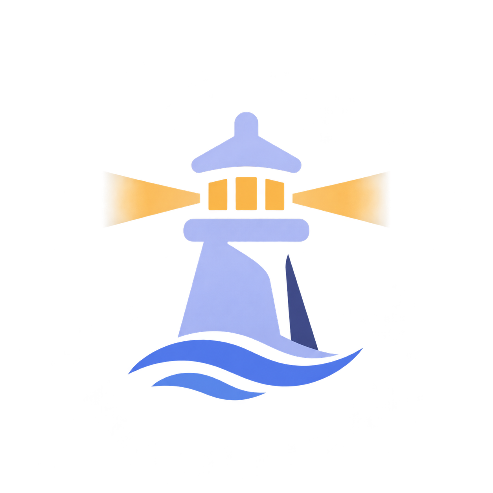

<p align="center">
  
</p>

<h1 align="center">DiffHarbor</h1>

<p align="center">
  <strong>Self-hosted AI code review for GitHub and GitLab.</strong><br>
  Runs your linters and tests, verifies every finding, posts only what holds up.
</p>

<p align="center">
  <a href="https://marcomaiermm.github.io/DiffHarbor/"></a>
  <a href="LICENSE.md"></a>
  <a href="go.mod"></a>
  <a href="https://github.com/marcomaiermm/DiffHarbor/commits/main"></a>
</p>

<p align="center">
  <a href="https://marcomaiermm.github.io/DiffHarbor/"><b>Docs</b></a> ·
  <a href="#quick-start">Quick start</a> ·
  <a href="#usage">Usage</a> ·
  <a href="#per-repo-settings">Per repo</a> ·
  <a href="#security">Security</a>
</p>

---

A small Go server takes the webhook and runs your checks on the changed lines. An agent reviews the diff in a checkout of the PR, and a second model checks every finding against the code before anything is posted.

## Highlights

- A second model verifies every finding and drops what it can't back up.
- Runs the checks your repo already has: tsc, eslint, biome, golangci-lint, gitleaks, osv-scanner, your tests [and more](https://marcomaiermm.github.io/DiffHarbor/how-it-works/#checks).
- A push reviews only what changed. A rebase reviews nothing.
- Fixes come as suggestion blocks you can commit from the PR. Fixed threads get resolved.
- Remembers corrections: tell it once, and the next reviews follow the rule.
- Works with OpenAI, Anthropic, DeepSeek, Bedrock, Azure OpenAI or your own gateway, with fallback to a second provider.
- One container, Go standard library only. Your code stays on your server and with your model provider.

## Quick start

```sh
cp compose.example.yml compose.yml
```

Create `.env` next to it:

```ini
GITHUB_APP_ID=123456
GITHUB_APP_PRIVATE_KEY_B64=...
GITHUB_WEBHOOK_SECRET=...
# or ANTHROPIC_API_KEY, DEEPSEEK_API_KEY, ...
OPENAI_API_KEY=...
```

```sh
docker compose up -d        # listens on :3000
```

Point your GitHub App's webhook at `https://<host>/webhook/github`. Nothing else needs to be public.

- [Create the GitHub App](https://marcomaiermm.github.io/DiffHarbor/configuration/#github): permissions and events
- [GitLab instead](https://marcomaiermm.github.io/DiffHarbor/configuration/#gitlab): `GITLAB_TOKEN`, `/webhook/gitlab`
- [Other model providers](https://marcomaiermm.github.io/DiffHarbor/configuration/#models)

## Usage

Reviews run when a PR opens and on every push. Drafts, bot PRs and PRs into other base branches are [skipped](https://marcomaiermm.github.io/DiffHarbor/how-it-works/#drafts-and-skipped-prs). Or ask in a comment:

```text
@<bot> review               # full review
@<bot> review all           # large PR, in parts
@<bot> review quiet         # only critical and major inline (quiet | chill | assertive)
@<bot> why is this a race?  # any question about the PR
@<bot> learnings            # rules the bot has saved
@<bot> forget <text>        # drop a rule
```

Reply in one of the bot's threads to discuss a finding. It answers, checks your fix or concedes.

## Per-repo settings

| File | |
|---|---|
| `.review/rules.md` | What to report and what to leave alone, in prose. |
| `.review/skills/` | Review skills in the [Agent Skills format](https://agentskills.io/specification). |
| `.review/checks.sh` | Your own checks. Their output goes into the review. |
| `review.json` | Settings. All keys are optional. |

```json
{
  "profile": "chill",
  "ignore": ["drizzle/meta", "**/*.fixture.ts"],
  "base_branches": ["develop", "release/*"],
  "packages": {
    "apps/web": { "min_severity": "major" }
  }
}
```

[All keys](https://marcomaiermm.github.io/DiffHarbor/per-repo/)

## Security

> [!WARNING]
> The checks and the agent run the PR's code, also for PRs from forks. Install the bot only on repos whose PR authors you trust.

- Forge and model keys stay with root. git, checks and the agent run as an unprivileged user per repo.
- [Exceptions](https://marcomaiermm.github.io/DiffHarbor/security/#what-the-prs-code-can-reach): Bedrock with IAM keys, a ChatGPT login and providers outside the models table. The PR's code can read those during a run.
- Model calls and git fetches go through a local proxy with tokens that expire with the job.
- No lifecycle scripts on install by default.

[Full threat model](https://marcomaiermm.github.io/DiffHarbor/security/)

## Documentation

- [How it works](https://marcomaiermm.github.io/DiffHarbor/how-it-works/): pipeline, chat, learnings, outcomes
- [Configuration](https://marcomaiermm.github.io/DiffHarbor/configuration/): forges, models, reports, tickets, npm registries
- [Per-repo settings](https://marcomaiermm.github.io/DiffHarbor/per-repo/): `review.json`, profiles, large PRs, monorepos
- [Security](https://marcomaiermm.github.io/DiffHarbor/security/): isolation and what a PR's code can reach
- [Development](https://marcomaiermm.github.io/DiffHarbor/development/): tests, lint, `diffharbor dry`

## Contributing

No external contributions at the moment. Bug reports as issues are welcome.

## License

[FSL-1.1-ALv2](LICENSE.md). Use it, change it, run it for your company. Don't offer it as a competing product or service. Each version becomes Apache-2.0 after two years.
